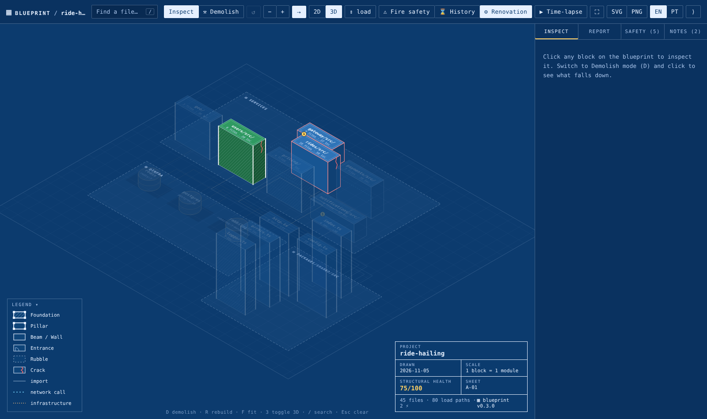
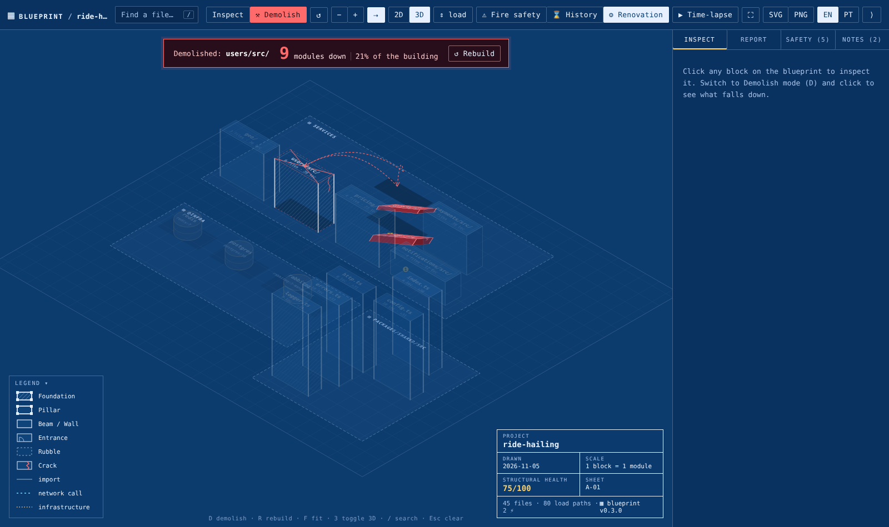
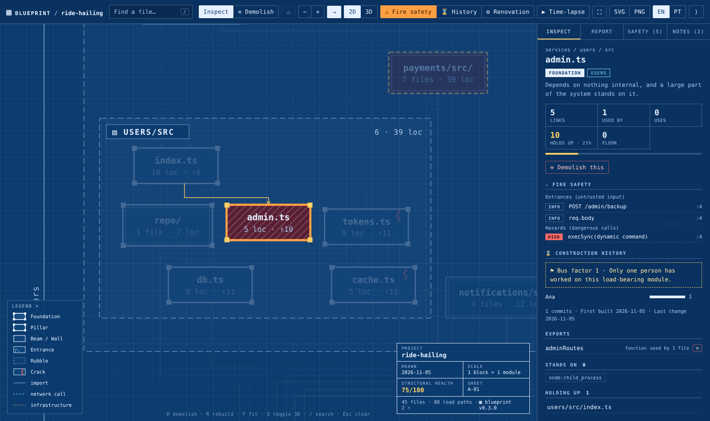
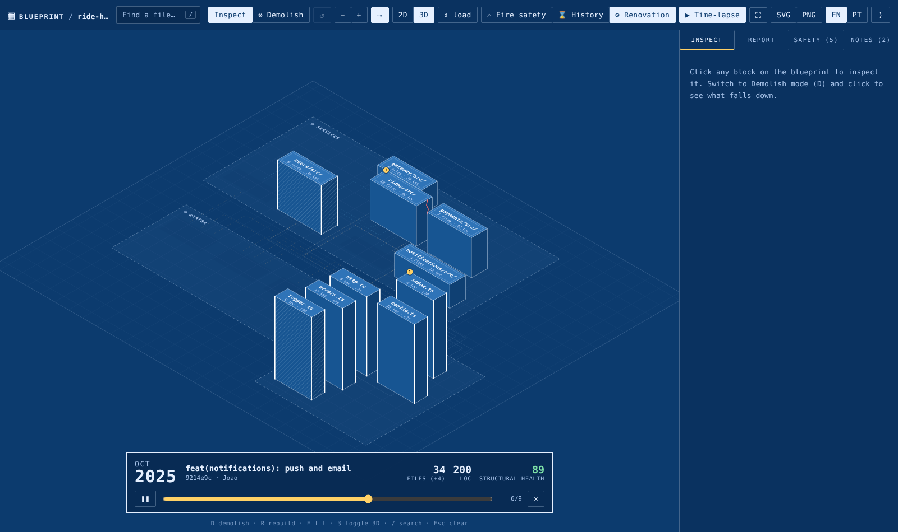
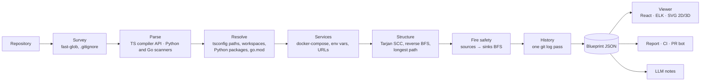

# ▦ blueprint

**Structural blueprints for codebases.** Blueprint reads a repository and draws it the way a structural engineer draws a building. It shows which modules are **pillars**, what stands on the **foundation**, where the **cracks** are, where a fire would spread, who built each wall, and what falls down if you take something out. You can view it in 2D or as a 3D isometric city.

```bash
npx code-blueprint .
```

Run it in the terminal of VS Code (or any terminal) inside your project, or install the VS Code extension. It analyses TypeScript, JavaScript, Python and Go, reads `docker-compose` to connect services, and opens an interactive blueprint.



## What it does

| | |
|---|---|
| **Demolition mode** | Click any file, folder or service and everything that depends on it turns red, wave by wave. In 3D the towers collapse. A banner shows how much of the building fell. |
| **3D isometric city** | Every module is a tower standing on its folder's plot. Height is either how much the module holds up (the skyline shows your load-bearing code) or its size. Pure SVG, exportable. |
| **Time-lapse** | `blueprint timelapse` films the construction from git history. Press ▶ and watch the towers rise commit by commit, with cracks appearing when they were introduced. |
| **PR bot** | A GitHub Action comments on every pull request with the blast radius, the pillars touched, new cracks and new fire routes, plus a Mermaid sketch of the renovation. It can fail the check on regressions. |
| **Fire safety** | Finds where untrusted input enters (HTTP routes, request bodies), where dangerous things happen (raw SQL, shell commands, `eval`, `innerHTML`, SSRF) and hard-coded secrets, then draws the module-level **fire routes** between them. |
| **Construction history** | Who built each module, how often it changes, **hotspots** (changed often and load-bearing) and **pillars only one person knows** (bus factor 1). |
| **Services** | `docker-compose` services become buildings. Calls such as `http://users:4001` and `postgres://…@postgres` found in env vars and code become network edges, across languages. Databases, caches and queues are drawn as infrastructure. |
| **Architect's notes** | An LLM writes a short note on each load-bearing module (`blueprint annotate`: Claude, OpenAI or a local Ollama). Your team adds notes too. Everything lives in `.blueprint/` and is committed with the code. |

| Demolition (3D) | Fire route | Time-lapse |
|---|---|---|
|  |  |  |

## Structural roles

| Symbol | Role | Meaning |
|---|---|---|
| hatched + corner columns | **Foundation** | depends on nothing internal, and a big share of the system stands on it |
| corner columns | **Pillar** | removing it brings down ≥ 15% of the building (`--pillar` to change) |
| thick outline | **Beam** | carries ≥ 5% of the load |
| outline | **Wall** | something leans on it |
| door | **Entrance** | entry point, route, test, script or config. Nothing depends on it, by design |
| dashed, faded | **Rubble** | nothing depends on it and it isn't an entrance: possibly dead code |
| red zig-zag | **Crack** | part of a circular dependency |
| cylinder | **Infrastructure** | Postgres, Redis, RabbitMQ… from `docker-compose` |

**Floors** are the longest dependency chain under a module (floor 0 is the foundation). **Holds up** is how many modules would break, directly or indirectly, if it disappeared. **Health** is a 0–100 score with an explained breakdown: cracks, rubble, coupling, height, giant files and fire hazards.

## Commands

```bash
blueprint [dir]                   # analyse + open the interactive blueprint (default)
blueprint [dir] --watch           # redraw live as you edit
blueprint export [dir]            # one self-contained blueprint.html (offline, GitHub Pages, Netlify…)
blueprint report [dir] --lang pt  # BLUEPRINT_REPORT.md, a structural inspection report
blueprint report --ci --max-cycles 0 --min-score 70   # fail CI on cracks or a low score
blueprint impact src/db.ts        # what breaks if this file changes or disappears?
blueprint impact --since main     # blast radius of your branch
blueprint diff --base main        # renovation plan: changed, new, demolished, affected, new cracks, new fire routes
blueprint diff --base main --format md     # the PR comment
blueprint timelapse [dir] -n 30   # film the construction from git history
blueprint annotate [dir]          # AI architect's notes
blueprint analyze -o bp.json      # raw JSON for your own tools
```

### PR bot

```yaml
# .github/workflows/blueprint.yml
name: blueprint
on: pull_request
permissions: { contents: read, pull-requests: write }
jobs:
  review:
    runs-on: ubuntu-latest
    steps:
      - uses: actions/checkout@v4
        with: { fetch-depth: 0 }
      - uses: actions/setup-node@v4
        with: { node-version: 20 }
      - uses: gianmateus/blueprint@main
        with:
          fail-on-new-cracks: 'true'
          fail-on-fire-routes: 'true'
```

Each pull request gets one comment that is updated on every push:

```text
▦ Blueprint · structural review 🔴
Health            84 → 75 (−9)
Blast radius      10 modules · 21% of the building
Pillars touched   users:cache.ts (holds up 11), users:index.ts (holds up 9)
Cracks            ⚠️ 1 new: users:cache.ts ⇄ users:tokens.ts
Fire routes       🔥 high · command-exec: gateway:middleware/auth.ts → users:index.ts → users:admin.ts
```

The interactive blueprint of the PR is uploaded as a build artifact, with the renovation layer on.

### AI notes

```bash
ANTHROPIC_API_KEY=… blueprint annotate . --lang pt          # Claude (default model: claude-haiku-5-5)
OPENAI_API_KEY=…    blueprint annotate . --provider openai --model <model>
blueprint annotate . --provider openai --base-url http://localhost:11434/v1 --model llama3.1   # Ollama
```

### VS Code extension

`vscode/` contains the extension (`npm run package` builds a `.vsix`). It adds:
- **Blueprint: Open structural blueprint**, from the layers icon in the editor title bar. The viewer opens beside your code, and clicking a block opens the file.
- **What breaks if I change this file?** in the right-click menu.
- A status bar entry for the current file, e.g. `▦ pillar · holds up 12 (27%)`.

The blueprint redraws on save.

### In the viewer

`D` demolish · `R` rebuild · `F` fit · `3` toggle 3D · `/` search · `+`/`−` open or close a level · double-click a room to open or close it · `Esc` clear. The layer buttons are **Fire safety**, **History**, **Renovation** (after `diff`) and **Time-lapse** (after `timelapse`). Export the drawing as SVG or PNG with a title block.

## How it works



- **Parsing**: TypeScript/JavaScript use the TypeScript compiler API in syntax-only mode (no type-checking, so thousands of files take about a second). Python and Go have regular import syntax, so careful line scanners are enough.
- **Cracks** are strongly connected components (Tarjan). **Floors** are the longest path in the condensed DAG. **Demolition** is a breadth-first walk over reverse dependencies, and the wave number drives the animation.
- **Fire routes** are a breadth-first walk from every module that receives untrusted input to every module with a dangerous call. It is module-level reachability, a triage map rather than taint tracking. Test files are excluded, and findings in build scripts are downgraded.
- **Diff and time-lapse** extract past commits with `git archive` into a temp folder. Your working tree is never touched.
- **3D** is an isometric projection drawn in SVG: `screen = ((x − y)·cos30°, (x + y)·sin30° − z)`, faces painted far to near. Roof labels are drawn with a matrix transform onto the roof plane.

Measured on a small cloud VM: [hono](https://github.com/honojs/hono) (451 files) takes about 1.2 s, and a 12-frame time-lapse of its history about 8 s. [excalidraw](https://github.com/excalidraw/excalidraw) (709 files, 207k lines) takes about 2 s.

## Try it

```bash
git clone https://github.com/gianmateus/blueprint && cd blueprint
npm install && npm run build
node dist/cli.js examples/ride-hailing      # 7 services in TypeScript, Python and Go + Postgres, Redis, RabbitMQ
npm link                                    # now `blueprint` works in any project
```

The example contains deliberate problems for the blueprint to find: a crack, a piece of rubble, an SQL injection fire route and a hard-coded key.

## Limitations

Static analysis can't see calls built at runtime (dynamic URLs, reflection, DI by string). Service edges are found by convention. Fire safety is heuristic and works at module level. The role thresholds and the health score are opinionated. Treat the drawing as a survey, not a guarantee.

## Roadmap

OpenTelemetry traces as runtime edges · Kubernetes manifests and OpenAPI/gRPC contracts · tree-sitter for more languages · side-by-side blueprint diff.

---

### Em português

**Blueprint** desenha a planta estrutural de um projeto de software, em 2D ou como uma cidade 3D isométrica. A planta mostra pilares, fundações, rachaduras (dependências circulares), entulho (código morto), rotas de incêndio (entrada não confiável chegando a uma operação perigosa) e quem construiu cada parede. No **modo demolição** você vê o que cai se remover um arquivo, uma pasta ou um serviço. Também tem time-lapse da obra pelo histórico do git, um bot que revisa pull requests, notas de IA e extensão para VS Code. A interface e o laudo (`blueprint report --lang pt`) estão em português.

MIT © Mateus Marques
